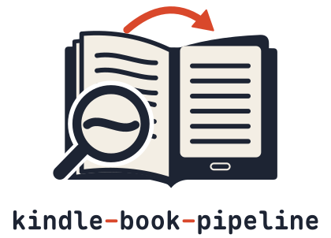
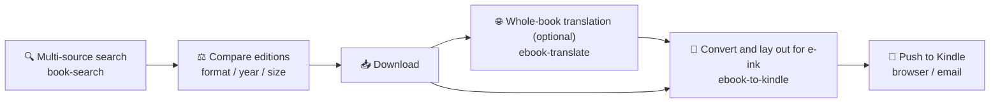
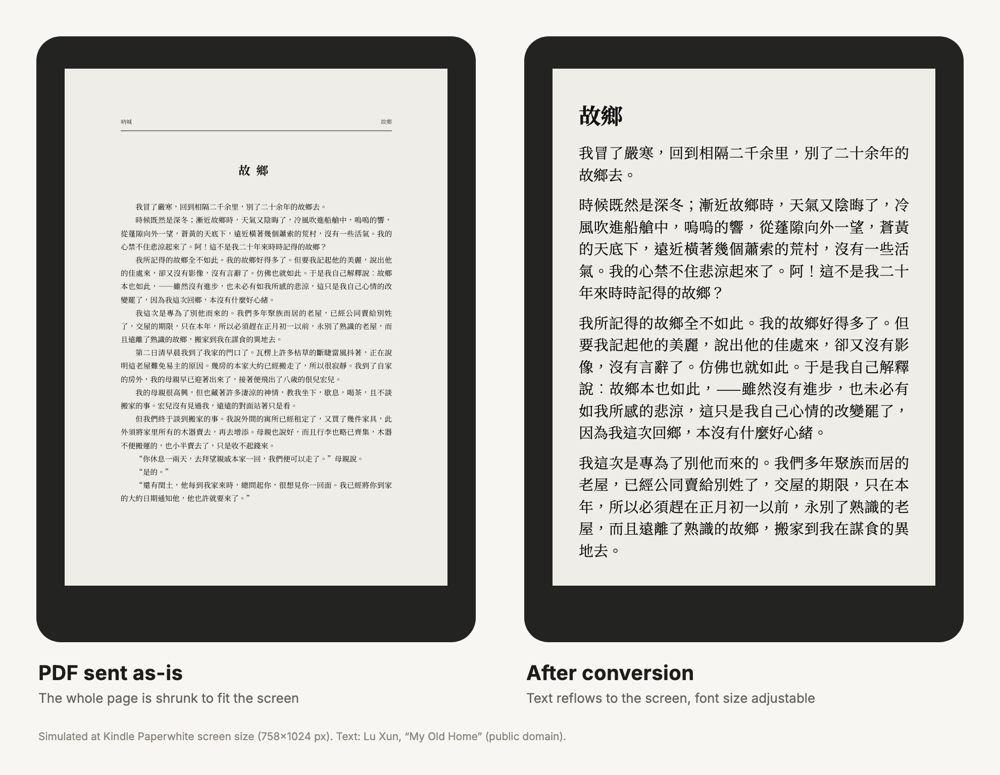

<p align="center">
  <picture>
    <source media="(prefers-color-scheme: dark)" srcset="docs/images/logo/logo-dark.svg">
    
  </picture>
</p>

# Kindle Book Pipeline

[中文](README.md) | English

> Find a book → pick an edition → convert it into an ebook that suits Kindle's e-ink screen → push it to your Kindle wirelessly.
> It is both a set of command-line tools and a set of Skills you can hand straight to an AI agent (Claude Code, Codex, etc.).
>
> The `SKILL.md` files and the notes under `references/` are written in Chinese; AI agents read them fine either way.

[](LICENSE)
[]()
[]()



## First time? Three things to tell your AI

1. **Have your AI install the three Skills.** Paste this into Claude Code, Codex, or another AI that can work with local files. You will get callable search, translation and conversion Skills:

   > Please install https://github.com/Ryumuu/kindle-book-pipeline and connect all three Skills using the README's “Use it with an AI agent” section. Check that my system is supported and preserve existing settings. Explain any runtime downloads and ask before installing them.

2. **Tell it what you want to do:**

   > Start using kindle-book-pipeline.

   The AI asks only the questions needed for finding, converting, sending or translating books, then saves non-sensitive preferences locally. Enter passwords and app passwords into account configuration yourself; do not send them to the AI.

3. **Get a first book you can open:**

   > Walk me through Project Gutenberg's public-domain Pride and Prejudice (gutenberg:1342). Tell me where the file is and how to open it.

   This no-login example is an English EPUB. Search-only users get the EPUB; if you choose conversion and the runtime is ready, the AI also builds an AZW3. First-time conversion needs about 3GB of runtime files; the AI asks before downloading them. Whole-book translation uses additional model quota and time. Without a Kindle, you can open EPUBs in a desktop reader.

Stuck? Say **“Run a health check”** (“体检一下”). Say “Change settings” (“改设置”) to adjust preferences. The [onboarding guide](book-search/references/onboarding.md) also explains how to start over.

## What it does

| Module | Purpose | Runs on |
| :--- | :--- | :--- |
| [`book-search/`](book-search/SKILL.md) | Search, compare and download ebooks across multiple sources. Sources are plugins, so you can add your own | Any OS, Python 3.9+, standard library only |
| [`ebook-translate/`](ebook-translate/SKILL.md) | Split foreign-language EPUBs for Agent translation; build a Chinese edition by default, or a paragraph-by-paragraph English/Chinese edition with `pack --bilingual` | Python 3.9+; Calibre required for compilation |
| [`ebook-to-kindle/`](ebook-to-kindle/SKILL.md) | Converts PDF / EPUB / DOCX / HTML / TXT / Markdown offline into AZW3 (or MOBI6, EPUB) tuned for Kindle Paperwhite, with automatic quality checks | Apple Silicon Mac, macOS 14+ |
| `ebook-to-kindle/scripts/send_to_kindle*.py` | Pushes the finished book to your Kindle: browser upload or the Send to Kindle email address | Browser mode needs macOS + the Ego browser (`ego-browser` CLI); email mode works on macOS / Linux (untested on Windows) |

What the conversion focuses on:

- Strips the fonts, font sizes, line heights and margins hard-coded in the source book and replaces them with relative sizes you can adjust on the Kindle;
- Joins hard line breaks from Chinese print books and removes stray spaces between Chinese characters;
- Generates a two-level clickable table of contents and reads the Kindle file back to verify the NCX;
- Keeps two-way links for footnotes and endnotes; notes missing from a PDF are marked as missing, never invented;
- Scanned PDFs go through an OCR route, and per-book rules can strip running-header watermarks.

The same page on a Kindle (left: the PDF as-is; right: after conversion):



## Quick start

```bash
git clone https://github.com/Ryumuu/kindle-book-pipeline.git
cd kindle-book-pipeline
```

Run all the commands below from the repo root, `kindle-book-pipeline/`.

### 1. Find a book

```bash
python3 book-search/scripts/book_search.py providers                     # list available sources
python3 book-search/scripts/book_search.py search "Pride and Prejudice"   # search every available source
python3 book-search/scripts/book_search.py download gutenberg:1342        # download using a ref from the search results
```

- Downloads go to `~/Downloads/Books/` by default; change it with `--out-dir` or the `BOOK_SEARCH_DOWNLOAD_DIR` environment variable.
- Two sources are built in:
  - `gutenberg`: public-domain books from Project Gutenberg, no login needed.
  - `zlibrary`: Z-Library, using your own account and your own daily quota. For how to log in, see [book-search/SKILL.md](book-search/SKILL.md#z-library-登录) (in Chinese).
- **Add your own source**: copy [`book-search/examples/my_provider.py`](book-search/examples/my_provider.py) to `~/.config/kindle-book-pipeline/providers/` and implement the two methods `search()` and `download()`. A plugin with the same name replaces the built-in source.
  - ⚠️ A plugin is ordinary Python code running with your permissions (it can read and write files and access the network), and it is executed as soon as sources are listed. Only install plugins you trust.

### 2. Convert

On first use, install the private runtime (Calibre, EPUBCheck, Java, Docling and so on; about 3 GB, installed under `~/.local/share/ebook-to-kindle` without touching system directories). To convert PDFs you must also install [uv](https://docs.astral.sh/uv/getting-started/installation/) yourself first and confirm `uv --version` works in your terminal; the installer will not install uv for you.

```bash
python3 ebook-to-kindle/scripts/bootstrap_runtime.py --component core --print-plan     # see what will be downloaded first
python3 ebook-to-kindle/scripts/bootstrap_runtime.py --component core --accept-download
python3 ebook-to-kindle/scripts/bootstrap_runtime.py --component pdf --accept-download  # install only when you need to convert PDFs
python3 ebook-to-kindle/scripts/ebook_to_kindle.py doctor --deep
```

Convert:

```bash
python3 ebook-to-kindle/scripts/ebook_to_kindle.py convert ~/Downloads/Books/book.epub --formats azw3,epub
python3 ebook-to-kindle/scripts/ebook_to_kindle.py convert book.pdf --formats azw3,epub --output-dir ~/KindleBooks
```

`--formats azw3,epub` produces both AZW3 (for copying onto the Kindle over USB) and EPUB (for wireless push).

- Conversion and translation output directories use this order: `--output-dir` > `EBOOK_TO_KINDLE_OUTPUT_DIR` > the profile's `output_dir` > `~/Documents/KindleBooks`.
- The whole conversion runs offline; third-party tools run inside a macOS sandbox with the network disabled.
- For more options (workspace reuse, PDF modes, metadata, note translation), see [ebook-to-kindle/SKILL.md](ebook-to-kindle/SKILL.md).

### 3. Push to Kindle

Amazon's Send to Kindle (web and email) does not accept AZW3/MOBI, so what gets pushed is the EPUB. If you pass an AZW3, the script automatically sends the same-named EPUB in the same directory instead.

**Browser mode** (macOS, reuses your Amazon login in the Ego browser):

```bash
python3 ebook-to-kindle/scripts/send_to_kindle.py ~/Documents/KindleBooks/book.epub --domain amazon.com --device "Paperwhite"
```

- `--domain` is your Amazon site (amazon.com, amazon.co.jp, amazon.co.uk, etc.). Precedence: CLI > `KINDLE_AMAZON_DOMAIN` > the profile's `amazon_domain` > `amazon.co.jp`. Device names use `--device` > `KINDLE_DEVICE_NAME` > the profile's `kindle_device_name` > no specified device.
- After uploading, the script tries to identify **the one document that was just added** and pushes only that to the device you specified (the identification method has limits; see below). If your account has several devices and you did not pass `--device`, or the name matches more than one device, it only uploads, does not push, and lists the device names for you to choose from.
- `DELIVERY_REQUESTED` in the result means a delivery request has been sent to Amazon; the device receives the book once it is online.
- On first use, when the library is still empty, the script cannot tell new documents from old ones, so it only uploads and does not push (the device will also receive the book on its next sync). If the page language is also neither Chinese nor English, the script cannot even confirm that the upload succeeded and reports `UPLOAD_UNCONFIRMED`.
- When you see `UPLOAD_UNCONFIRMED` or `BROWSER_PUSH_TIMEOUT`, the book may already have been uploaded; check "Manage Your Content and Devices" before retrying.
- Known limitation: the script has no identifier that maps one-to-one to this specific upload. It can only compare what is new in the library before and after the upload, then match by title (an identical title or one containing the other both count). If another upload from the same account also appears in the library during that window, and its title is the same or similar, the script may pick the wrong document and push that one to the device; when the page shows no recognizable success message, it may also wrongly judge this upload as successful. While using it, do not upload files with the same or similar titles through other channels at the same time, and watch for earlier uploads that are still being processed. To confirm exactly which document it was, check manually in "Manage Your Content and Devices".

**Email mode** (macOS / Linux; untested on Windows):

```bash
python3 ebook-to-kindle/scripts/send_to_kindle_email.py --init-config     # creates ~/.config/kindle/email_config.json (readable only by you)
# Edit the config: your Kindle email address, the sender address (must be on Amazon's "Approved Personal Document E-mail List"), and the SMTP app password
python3 ebook-to-kindle/scripts/send_to_kindle_email.py ~/Documents/KindleBooks/book.epub
```

## Use it with an AI agent

All three modules are standard agent Skills (each contains a `SKILL.md`). For example, in Claude Code:

```bash
mkdir -p ~/.claude/skills
ln -s "$PWD/book-search" ~/.claude/skills/book-search
ln -s "$PWD/ebook-translate" ~/.claude/skills/ebook-translate
python3 ebook-to-kindle/scripts/install_skill.py --target ~/.claude/skills/ebook-to-kindle
```

`install_skill.py` installs to `~/.agents/skills/ebook-to-kindle` by default and can also install to `~/.claude/skills` or `~/.codex/skills`. After that, just tell the agent something like "Find me an EPUB of *Pride and Prejudice*, pick the best edition, convert it to Kindle format and send it to my Paperwhite." The `book-search` Skill requires the agent to list an edition comparison table before downloading, so you don't waste download quota.

## Repository layout

```text
kindle-book-pipeline/
├── book-search/
│   ├── SKILL.md                    # Agent usage: four-stage search workflow, comparison criteria
│   ├── examples/my_provider.py     # Template for a custom source
│   ├── tests/                      # Offline unit tests (plugin loading, safe download)
│   └── scripts/
│       ├── book_search.py          # CLI entry point
│       └── booksearch/             # Provider base class, plugin loader, download helpers
│           └── providers/          # Built-in sources: gutenberg, zlibrary
├── ebook-translate/
│   ├── SKILL.md                    # Agent instructions: unpack, faithful translation, pack
│   └── scripts/
│       └── ebook_translate.py      # CLI tool (unpack / status / pack)
└── ebook-to-kindle/
    ├── SKILL.md                    # Agent usage: convert, verify, push
    ├── assets/                     # PW2 stylesheet and pinned Docling dependencies
    ├── references/                 # Notes on quality gates, runtime, workspaces, note translation, etc.
    ├── security/                   # Network and permission boundary docs
    ├── evals/                      # Test set and synthetic acceptance samples
    └── scripts/
        ├── ebook_to_kindle.py      # Conversion entry point (convert / doctor / review)
        ├── ebook_kindle/           # Conversion pipeline
        ├── bootstrap_runtime.py    # Installs the private runtime
        ├── localize_notes.py       # Optional: note translation (needs Codex CLI)
        ├── clean_scan_text.py      # Cleans text from scanned books
        ├── send_to_kindle.py       # Push: browser mode
        ├── send_to_kindle_email.py # Push: email mode
        ├── install_skill.py
        └── uninstall.py            # Dry run by default; deletes only after you confirm
```

## Tests

```bash
python3 -m unittest discover -s book-search/tests -t book-search/tests
cd ebook-to-kindle && python3 -m unittest discover -s evals -p "test_*.py"
```

## Configuration and credentials

All personal information stays on your machine and never enters the repo:

| Purpose | Location |
| :--- | :--- |
| First-use preferences (no credentials) | `~/.config/kindle-book-pipeline/profile.json` (permissions 600); override the path with `KINDLE_BOOK_PIPELINE_PROFILE`. Use `pipeline_setup.py status / save / doctor / reset` to view, edit, check or start over |
| Z-Library login | Environment variables `ZLIB_REMIX_USERID` / `ZLIB_REMIX_USERKEY`, or `~/.config/zlibrary/config.json` (permissions 600) |
| Kindle email push | `~/.config/kindle/email_config.json` (permissions 600); the password can also be supplied via `KINDLE_SMTP_PASS` |
| Custom sources | `~/.config/kindle-book-pipeline/providers/*.py`, or `$BOOK_SEARCH_PROVIDER_PATH` |

## Copyright and usage boundaries

- This project does not remove DRM. It only handles books and documents that you have the right to obtain legally, convert, and use for your intended purpose.
- Being able to find something in search results does not mean the content is licensed.
- Users choose their own book sources and are responsible for complying with each source's terms of service and the laws where they live.
- This project is not affiliated with Z-Library, Project Gutenberg or Amazon.

## License

[MIT](LICENSE)
