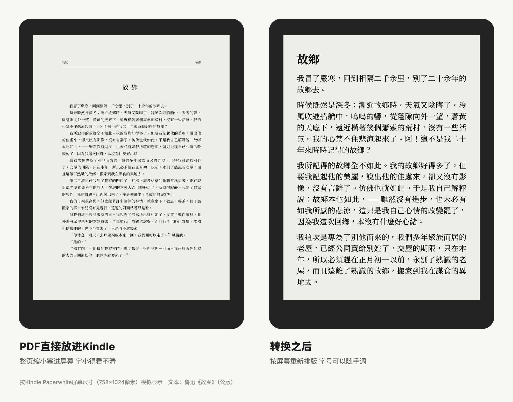

<p align="center">
  <picture>
    <source media="(prefers-color-scheme: dark)" srcset="docs/images/logo/logo-dark.svg">
    
  </picture>
</p>

# Kindle Book Pipeline

中文 | [English](README.en.md)

> 找书 → 挑版本 → 转成适合 Kindle 墨水屏的电子书 → 无线推送到 Kindle。
> 既是一组命令行工具，也是可以直接交给 AI Agent（Claude Code / Codex 等）使用的 Skill。

[](LICENSE)
[]()
[]()


## 能做什么

| 模块 | 作用 | 运行环境 |
| :--- | :--- | :--- |
| [`book-search/`](book-search/SKILL.md) | 多平台检索、对比、下载电子书。找书平台是插件，可以自己加 | 任意系统，Python 3.9+，只用标准库 |
| [`ebook-translate/`](ebook-translate/SKILL.md) | 外语 EPUB 分章、由 Agent 翻译后生成默认中文精排版，或用 `pack --bilingual` 生成逐段中英对照版 | Python 3.9+；编译需 Calibre |
| [`ebook-to-kindle/`](ebook-to-kindle/SKILL.md) | 把 PDF / EPUB / DOCX / HTML / TXT / Markdown 离线转成适合 Kindle Paperwhite 的 AZW3（或 MOBI6、EPUB），带自动质量检查 | Apple Silicon Mac，macOS 14+ |
| `ebook-to-kindle/scripts/send_to_kindle*.py` | 把成品推送到 Kindle：浏览器上传或 Send to Kindle 邮箱 | 浏览器模式需 macOS + Ego 浏览器（`ego-browser` 命令行）；邮件模式在 macOS / Linux 上可用（Windows 未测试） |

转换效果的重点：

- 去掉源书写死的字体、字号、行高和边距，换成 Kindle 上可调的相对字号；
- 合并中文纸书硬换行，去掉中文字符之间多余的空格；
- 生成两级可点击目录，并回读 Kindle 文件校验 NCX；
- 脚注、尾注保留双向跳转；PDF 中缺失的注释只标明缺失，不编造；
- 扫描版 PDF 走 OCR 路线，可用每本书自己的规则去掉页眉水印。

同一页书在 Kindle 上的样子（左：PDF 原样；右：转换后）：



## 快速开始

```bash
git clone https://github.com/Ryumuu/kindle-book-pipeline.git
cd kindle-book-pipeline
```

下面的命令都在仓库根目录 `kindle-book-pipeline/` 下执行。

### 1. 找书

```bash
python3 book-search/scripts/book_search.py providers                     # 看有哪些平台可用
python3 book-search/scripts/book_search.py search "Pride and Prejudice"   # 搜所有可用平台
python3 book-search/scripts/book_search.py download gutenberg:1342        # 用搜索结果里的 ref 下载
```

- 默认下载到 `~/Downloads/Books/`，可用 `--out-dir` 或环境变量 `BOOK_SEARCH_DOWNLOAD_DIR` 改。
- 内置两个平台：
  - `gutenberg`：Project Gutenberg 公版书，免登录。
  - `zlibrary`：Z-Library，用你自己的账号和每日额度，登录方式见 [book-search/SKILL.md](book-search/SKILL.md#z-library-登录)。
- **加自己的平台**：复制 [`book-search/examples/my_provider.py`](book-search/examples/my_provider.py) 到 `~/.config/kindle-book-pipeline/providers/`，实现 `search()` 和 `download()` 两个方法即可。同名插件会替换内置平台。
  - ⚠️ 插件是以你的权限运行的普通 Python 代码（能读写文件、联网），列平台时就会执行，只装你信得过的。

### 2. 转换

首次使用先安装私有运行环境（Calibre、EPUBCheck、Java、Docling 等，约 3 GB，装在 `~/.local/share/ebook-to-kindle`，不碰系统目录）。要转 PDF 的话，还得先自己装好 [uv](https://docs.astral.sh/uv/getting-started/installation/)，并用 `uv --version` 确认终端里能用；安装器不会替你装 uv。

```bash
python3 ebook-to-kindle/scripts/bootstrap_runtime.py --component core --print-plan     # 先看要下载什么
python3 ebook-to-kindle/scripts/bootstrap_runtime.py --component core --accept-download
python3 ebook-to-kindle/scripts/bootstrap_runtime.py --component pdf --accept-download  # 需要转 PDF 时再装
python3 ebook-to-kindle/scripts/ebook_to_kindle.py doctor --deep
```

转换：

```bash
python3 ebook-to-kindle/scripts/ebook_to_kindle.py convert ~/Downloads/Books/book.epub --formats azw3,epub
python3 ebook-to-kindle/scripts/ebook_to_kindle.py convert book.pdf --formats azw3,epub --output-dir ~/KindleBooks
```

`--formats azw3,epub` 同时出 AZW3（USB 拷进 Kindle 用）和 EPUB（无线推送用）。

- 成品默认存到 `~/Documents/KindleBooks`，可用 `--output-dir` 或环境变量 `EBOOK_TO_KINDLE_OUTPUT_DIR` 改。
- 转换全程离线，第三方工具都在 macOS 沙箱里禁网运行。
- 更多参数（工作区复用、PDF 模式、元数据、注释翻译）见 [ebook-to-kindle/SKILL.md](ebook-to-kindle/SKILL.md)。

### 3. 推送到 Kindle

亚马逊 Send to Kindle（网页和邮件）都不收 AZW3/MOBI，所以推送的是 EPUB；你传 AZW3 时脚本会自动改传同目录的同名 EPUB。

**浏览器模式**（macOS，复用你在 Ego 浏览器里的亚马逊登录）：

```bash
python3 ebook-to-kindle/scripts/send_to_kindle.py ~/Documents/KindleBooks/book.epub --domain amazon.com --device "Paperwhite"
```

- `--domain` 填你的亚马逊站点（amazon.com、amazon.co.jp、amazon.co.uk 等），也可以设环境变量 `KINDLE_AMAZON_DOMAIN`；都不写时默认 `amazon.co.jp`。
- 上传后会尝试认出**这次新增的那一本**，只把它推到你指定的设备（识别方法有局限，见下）；账号下有多台设备又没写 `--device`、或名字能对上好几台时，只上传、不推送，并列出设备名供你选择。
- 结果里的 `DELIVERY_REQUESTED` 表示已向亚马逊发出传送请求，设备联网后收到。
- 首次使用、书库还是空的时，脚本分不清新旧文档，只上传不推送（设备下次同步也会收到）；如果页面语言又不是中文/英文，脚本连上传成功都确认不了，会报 `UPLOAD_UNCONFIRMED`。
- 报 `UPLOAD_UNCONFIRMED` 或 `BROWSER_PUSH_TIMEOUT` 时书可能已经传上去了，先去「管理内容和设备」看一眼再重试。
- 已知局限：脚本拿不到能和这次上传一一对应的编号，只能看上传前后书库多了什么、再按书名匹配（书名完全相同或包含关系都算）。如果这段时间里同一账号的另一笔上传也出现在书库里，且书名相同或相近，脚本可能认错文档、把那一份推到设备上；页面没显示可识别的成功提示时，也可能误判这次上传成功。使用时别在其他入口同时传相同或相近书名的文件，也留意之前还没处理完的上传；要确认具体是哪一份，去「管理内容和设备」人工核对。

**邮件模式**（macOS / Linux；Windows 未测试）：

```bash
python3 ebook-to-kindle/scripts/send_to_kindle_email.py --init-config     # 生成 ~/.config/kindle/email_config.json（仅自己可读）
# 编辑配置：Kindle 收件邮箱、发件邮箱（需在亚马逊「已认可的发件人」里）、SMTP 授权码
python3 ebook-to-kindle/scripts/send_to_kindle_email.py ~/Documents/KindleBooks/book.epub
```

## 交给 AI Agent 使用

三个模块都是标准的 Agent Skill（含 `SKILL.md`）。例如在 Claude Code 中：

```bash
mkdir -p ~/.claude/skills
ln -s "$PWD/book-search" ~/.claude/skills/book-search
ln -s "$PWD/ebook-translate" ~/.claude/skills/ebook-translate
python3 ebook-to-kindle/scripts/install_skill.py --target ~/.claude/skills/ebook-to-kindle
```

`install_skill.py` 默认装到 `~/.agents/skills/ebook-to-kindle`，也可装到 `~/.claude/skills` 或 `~/.codex/skills`。之后对 Agent 说「帮我找《某本书》的 EPUB，挑最好的版本，转成 Kindle 格式发到我的 Paperwhite」即可。`book-search` 的 Skill 会要求 Agent 先列出版本对比表再下载，避免浪费下载额度。

## 目录结构

```text
kindle-book-pipeline/
├── book-search/
│   ├── SKILL.md                    # Agent 用法：四阶段找书流程、对比标准
│   ├── examples/my_provider.py     # 自定义平台模板
│   ├── tests/                      # 离线单测（插件加载、安全下载）
│   └── scripts/
│       ├── book_search.py          # 命令行入口
│       └── booksearch/             # Provider 基类、插件加载、下载工具
│           └── providers/          # 内置平台：gutenberg、zlibrary
├── ebook-translate/
│   ├── SKILL.md                    # Agent 用法：分章解包、高保真逐章断点续译
│   └── scripts/
│       └── ebook_translate.py      # CLI 工具（unpack / status / pack）
└── ebook-to-kindle/
    ├── SKILL.md                    # Agent 用法：转换、验收、推送
    ├── assets/                     # PW2 样式与 Docling 依赖锁定
    ├── references/                 # 质量门、运行环境、工作区、注释翻译等说明
    ├── security/                   # 网络与权限边界说明
    ├── evals/                      # 测试集与合成验收样例
    └── scripts/
        ├── ebook_to_kindle.py      # 转换入口（convert / doctor / review）
        ├── ebook_kindle/           # 转换流水线
        ├── bootstrap_runtime.py    # 安装私有运行环境
        ├── localize_notes.py       # 可选：注释翻译（需 Codex CLI）
        ├── clean_scan_text.py      # 扫描书文本净化
        ├── send_to_kindle.py       # 推送：浏览器模式
        ├── send_to_kindle_email.py # 推送：邮件模式
        ├── install_skill.py
        └── uninstall.py            # 默认只演练，确认后才删除
```

## 测试

```bash
python3 -m unittest discover -s book-search/tests -t book-search/tests
cd ebook-to-kindle && python3 -m unittest discover -s evals -p "test_*.py"
```

## 配置与凭证

所有个人信息只存在本机，不进仓库：

| 用途 | 位置 |
| :--- | :--- |
| Z-Library 登录 | 环境变量 `ZLIB_REMIX_USERID` / `ZLIB_REMIX_USERKEY`，或 `~/.config/zlibrary/config.json`（600 权限） |
| Kindle 邮件推送 | `~/.config/kindle/email_config.json`（600 权限），密码也可用 `KINDLE_SMTP_PASS` |
| 自定义找书平台 | `~/.config/kindle-book-pipeline/providers/*.py`，或 `$BOOK_SEARCH_PROVIDER_PATH` |

## 版权与使用边界

- 本项目不去除 DRM，只处理你有权合法获取、转换并按你的用途使用的书和文档。
- 搜索结果能搜到，不代表这份内容已获授权。
- 找书平台由使用者自行选择，各平台的服务条款与所在地法律由使用者自行遵守。
- 本项目与 Z-Library、Project Gutenberg、亚马逊均无隶属关系。

## License

[MIT](LICENSE)
